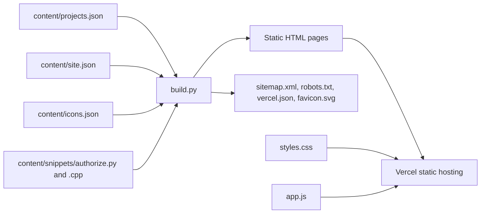

<div align="center">

# Miracle Agbebaku: Portfolio

**A hand-built, framework-free portfolio with a content-driven static generator, a motion system and typed-code storytelling.**

[Live site](https://miracle-agbebaku-portfolio.vercel.app) · [Projects](https://miracle-agbebaku-portfolio.vercel.app/projects.html) · [Contact](https://miracle-agbebaku-portfolio.vercel.app/contact.html)

</div>

---

## Contents

1. [Highlights](#highlights)
2. [Pages](#pages)
3. [How it is built](#how-it-is-built)
4. [Repository layout](#repository-layout)
5. [Getting started](#getting-started)
6. [Editing content](#editing-content)
7. [Design system](#design-system)
8. [Motion system](#motion-system)
9. [Accessibility](#accessibility)
10. [Performance](#performance)
11. [Browser support](#browser-support)
12. [Security and privacy](#security-and-privacy)
13. [Testing](#testing)
14. [Deployment](#deployment)
15. [Credits](#credits)

---

## Highlights

- **No framework, no bundler.** Plain HTML, CSS and JavaScript. Nothing to install to run or deploy it.
- **Content-driven.** Projects, stack and navigation live in JSON. A small Python script (standard library only) generates every page, the sitemap and the robots file.
- **Motion with a purpose.** Letter-by-letter name reveal, a looping "propose / authorize / run" illustration, a typed Python and C++ code panel, stacked scroll cards, two-direction technology marquees, a full-screen animated menu, shared-element page transitions and a scroll progress line.
- **Real icons.** Brand and UI icons are real SVG paths inlined into the HTML, not icon fonts or placeholders.
- **Light and dark themes** with a remembered preference and no flash on load.
- **Accessible by default.** Keyboard operable, visible focus, 44px touch targets, reduced-motion support and a pause control for moving content.
- **Contact details are never written in the HTML.** They are assembled in the browser, so they are not in the page source as plain text.

## Pages

| Page | File | Purpose |
| --- | --- | --- |
| Home | `index.html` | Branded entry page with clear routes into the portfolio and About page |
| Portfolio | `portfolio.html` | Hero, what I build, typed code panel, selected work, technology marquee |
| Projects | `projects.html` | All projects with working status filters |
| Project pages | `nexus-core.html`, `ella.html`, `carecore.html`, `atelier.html`, `engine.html`, `ultimate-agentic-ai.html`, `lagoon.html`, `aurora.html` | Each project's purpose, what it is for, tech, and (where relevant) an interactive overview of how it works |
| Engineering | `engineering.html` | Journal landing page |
| About | `about.html` | Animated profile, principles and interactive terminal with 50+ programming-language views |
| Website language | Shared header control | Compact searchable language picker backed by Google Translate |
| Resume | `resume.html` | Focus areas, technologies, projects, links |
| Contact | `contact.html` | WhatsApp, email, X, Instagram, GitHub |
| 404 | `404.html` | Not-found page |

## How it is built



`build.py` reads the JSON content, syntax-highlights the code snippets, draws each project's SVG motif and writes the pages. The generated files are committed, so the site deploys as plain static files with no build step on the host.

## Repository layout

```text
.
├── build.py                  # static generator (standard library only)
├── content/
│   ├── projects.json         # the project list and copy
│   ├── site.json             # name, domain, navigation, technology marquee
│   ├── icons.json            # SVG path data for every icon used
│   └── snippets/
│       ├── authorize.py      # code shown in the typed panel (Python)
│       └── authorize.cpp     # code shown in the typed panel (C++)
├── styles.css                # design tokens, layout, motion
├── app.js                    # theme, menu, typing, reveals, filters, contact links
├── tests/smoke.py            # browser smoke test
├── *.html                    # generated pages
├── sitemap.xml  robots.txt   # generated
├── vercel.json               # security headers
└── favicon.svg
```

## Getting started

```bash
# preview
python3 -m http.server 8000      # then open http://localhost:8000

# regenerate pages after editing content/
python3 build.py
```

Requirements: Python 3 for the generator. A browser for everything else.

## Editing content

### Add or change a project

Edit `content/projects.json`. Each entry:

| Field | Required | Notes |
| --- | --- | --- |
| `slug` | yes | Becomes `<slug>.html` and the shared-element transition name |
| `name` | yes | Display name |
| `state` | yes | `Live`, `In development` or `Coming soon` |
| `purpose` | yes | One sentence on what the project is for |
| `summary` | yes | A short paragraph |
| `points` | yes | List of what it is for |
| `motif` | yes | One of `nexus`, `ella`, `carecore`, `atelier`, `engine`, `agent`, `lagoon`, `aurora` |
| `url` | no | A deployment link. Omit it and no button is shown |
| `link_label` | no | Text of the deployment button |
| `tech` | no | Technology names; those in `site.json` get their icon |
| `flow` | no | An interactive step overview: `title`, `note`, `steps` as `[name, description]`; use `["BOUNDARY", "label"]` for a boundary marker |

Then run `python3 build.py` and commit.

### Technologies in the marquee

Edit the `stack` list in `content/site.json` as `["Display name", "icon-id"]`. The icon id must exist in `content/icons.json`.

### The typed code panel

Replace `content/snippets/authorize.py` and `authorize.cpp`. Keep them runnable: they are shown as real code.

### Contact links

Contact details are deliberately **not** in the HTML. They live at the bottom of `app.js` and are written into link `href` values at load. Change them there.

### Domain

Set `domain` in `content/site.json`, rebuild, and the canonical links, Open Graph URLs and sitemap update together.

## Design system

Defined as CSS custom properties at the top of `styles.css`.

| Token | Dark | Light |
| --- | --- | --- |
| `--bg` | `#0b0b0d` | `#f2eee6` |
| `--bg2` | `#121214` | `#e8e3d8` |
| `--card` | `#17171a` | `#faf7f0` |
| `--ink` | `#f2eee6` | `#121212` |
| `--mute` | `#a8a398` | `#5a554b` |
| `--rule` | `#2b2a27` | `#cdc6b6` |
| `--acc` (signal vermilion) | `#ff5a36` | `#c93810` |
| `--ok` (live status only) | `#3ddc84` | `#16894a` |

- **Type:** Instrument Serif for display (with an italic accent), Geist for text and Geist Mono for labels and code, each with system fallbacks. Italic accent words use the `.it` class.
- **Theme:** a tiny inline script in each page `<head>` applies the saved or system theme before first paint. Without JavaScript, the system preference is used.
- **Status chips:** `Live` (filled dot), `In development` (half dot), `Coming soon` (dashed ring). Status is always a text label as well as a shape.

## Home page choreography

| Piece | What it does | Fallback |
| --- | --- | --- |
| Hero headline | Masked line-by-line reveal | Instant, fully visible |
| Hero photo | Pointer tilt, soft spotlight and light scroll parallax (fine pointers only) | Static photo |
| Approach story | Pinned on large screens; scroll position drives the token and the active step | Stacked, all steps visible on phones, short screens and reduced motion |
| Project rail | Scroll-snap carousel with arrows, progress bar, mouse drag and a card spotlight | Native horizontal scrolling |
| Technology marquee | Two opposite rows, pausable | Static wrapped list |

## Motion system

One easing curve, `cubic-bezier(.2,.8,.2,1)`, and a small set of durations:

| Use | Duration |
| --- | --- |
| Hover and focus feedback | 250–300 ms |
| Reveals and panel changes | 450–900 ms |
| Menu and page transitions | 450–650 ms |
| Marquees | 48–60 s per loop |

Rules the code follows:

- Animate `transform` and `opacity` wherever possible.
- Continuous animations only run while visible (the hero illustration pauses off-screen). Marquees can be paused with the on-page control and pause on hover.
- Typed text types once, and the full code is always available to assistive technology.
- Navigation is never blocked while a transition plays.
- With `prefers-reduced-motion`, animation and transitions are effectively removed, marquees become static wrapped lists, the typed code appears complete and page transitions are off.

## Translation

The language picker uses Google Translate's engine, but all of Google's own interface (top banner, tooltips, highlights) is hidden with CSS and removed by a small observer in `app.js`. The picker keeps its attribution line. Code samples, names and the language list are marked `translate="no"`.

## Accessibility

- Skip link, landmarks, one `h1` per page.
- Visible focus rings on every interactive element.
- Touch targets of at least 44 px in the main interface.
- The full-screen menu closes with `Escape` and returns focus to its button.
- Decorative motion (marquee band, illustration, motifs) is hidden from assistive technology; the typed code has a plain-text equivalent.
- The marquee has a pause control.
- Status is conveyed by text, not colour alone.
- External links open in a new tab with `rel="noopener noreferrer"` and announce that to screen readers.

## Performance

- No framework or build step on the host. `styles.css` is about 22 KB and `app.js` about 6 KB, uncompressed.
- Pages are generated static HTML; icons are inline SVG, so there are no icon-font requests. The only external request is Google Fonts, with system-font fallbacks.
- Scroll-linked and reveal effects use `IntersectionObserver` and CSS, not scroll listeners (the header-hide behaviour uses a single throttled passive listener).

## Browser support

Core layout and interactions need a current evergreen browser. Newer features are progressive enhancements and degrade to normal behaviour:

| Feature | Where unsupported |
| --- | --- |
| Shared-element page transitions (View Transitions) | Normal page navigation |
| Scroll progress line (CSS scroll-driven animation) | The line is not shown |
| `clip-path` menu reveal | Menu still opens and closes |

## Security and privacy

- Contact details are assembled in the browser and are not in the HTML source.
- `vercel.json` sets `X-Content-Type-Options`, `Referrer-Policy` and `X-Frame-Options` headers.
- There is no backend, database, form or tracking script.
- Private dashboards, tokens and environment settings are never linked or committed.

## Testing

A browser smoke test checks every page at 320, 390, 820 and 1440 px for console errors, horizontal overflow, small touch targets and broken internal links.

```bash
pip install playwright && playwright install chromium
python3 tests/smoke.py
```

It does not replace checking the deployed site on a real phone, especially web fonts and page transitions.

## Deployment

Deploys as static files.

**Vercel:** import the repository, set the framework preset to *Other*, and leave the build command and output directory empty. Every push to `main` redeploys.

Any static host works. After a custom domain is attached, update `domain` in `content/site.json` and run `python3 build.py`.

## Credits

- Icons: [Simple Icons](https://simpleicons.org) (CC0) and [Material Design Icons](https://pictogrammers.com/library/mdi/) (Apache 2.0). Brand logos remain the trademarks of their owners.
- Fonts: Bricolage Grotesque and Hanken Grotesk through Google Fonts (SIL Open Font License).
- No open-source license has been added to this repository.
